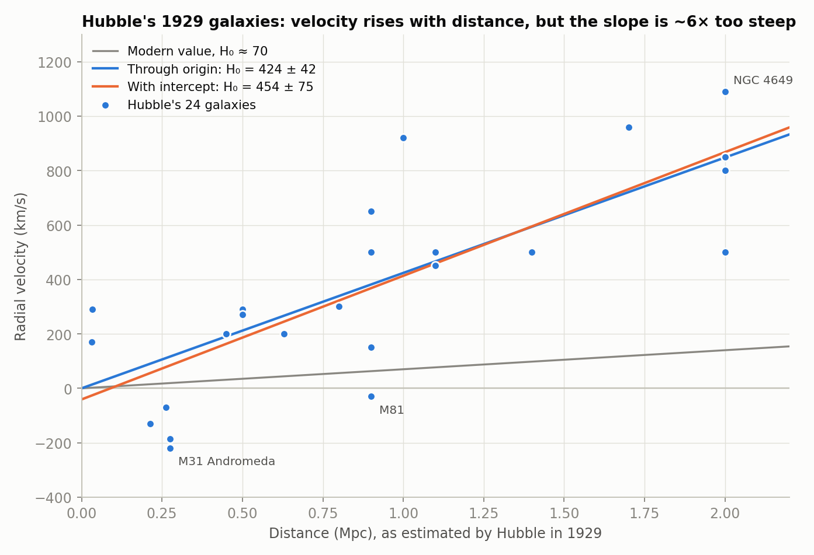
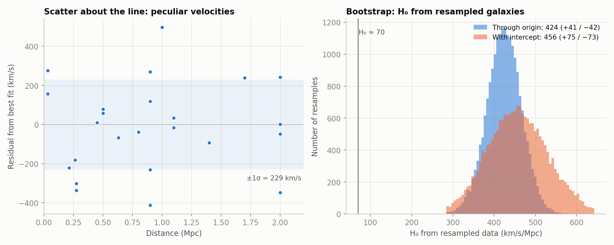
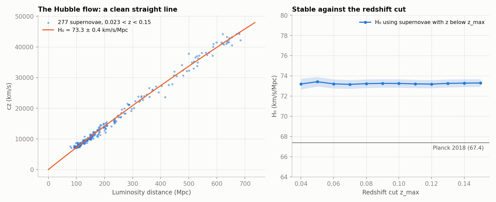
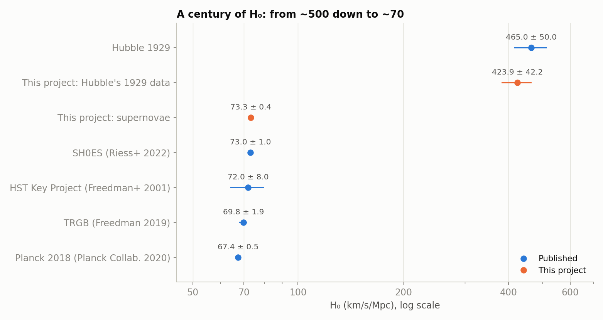
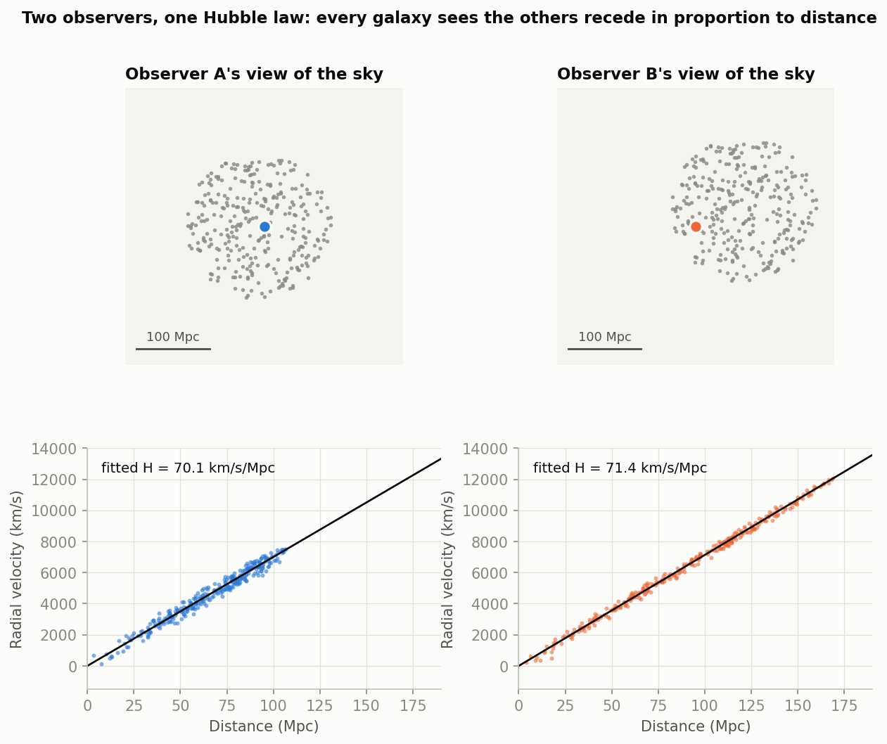
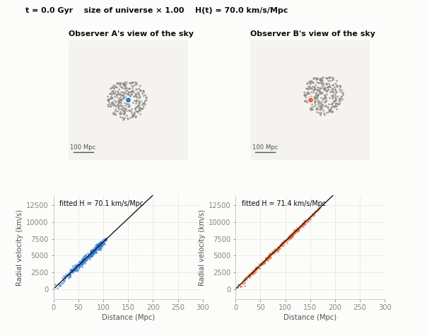

# Hubble's law: from Hubble's 1929 galaxies to modern supernovae

A Python project that redoes the measurement that discovered the expanding universe, twice: once with Hubble's own 24 galaxies (1929), and once with modern Type Ia supernovae (Pantheon+, 2022). It fits both properly, with error bars, and simulates an expanding universe to show why every observer sees the same law.



## Headline results

| Measurement | H₀ (km/s/Mpc) | 1/H₀ |
|---|---|---|
| Hubble's 24 galaxies, fit through the origin | **424 ± 42** | 2.3 Gyr |
| Hubble's 24 galaxies, fit with an intercept | **454 ± 75** | 2.2 Gyr |
| Hubble's own published value (also fits the Sun's motion) | 465 ± 50 | 2.1 Gyr |
| 277 supernovae in the Hubble flow (0.023 < z < 0.15) | **73.3 ± 0.4** (statistical) | 13.3 Gyr |

- Hubble's slope is about **6× too steep**, and his data implies a universe **younger than the Earth** (4.5 Gyr). The problem was never the velocities. It was the distances (see [Why 1929 was wrong](#why-1929-was-so-wrong)).
- The modern supernovae give a clean straight line with **H₀ ≈ 73**, stable against the redshift cut.

## How this was built

I've been teaching myself Python alongside my A-level studies. I built this project with Claude (Anthropic's AI assistant), which wrote most of the code. I chose the problem and what to test, and I'm working through the code, including the NumPy, to understand the numerical methods in detail.

## Run it

```bash
python3 -m venv .venv && source .venv/bin/activate
pip install -r requirements.txt
python hubbles_law.py
open figures/fig1_hubble_1929.png        # macOS
```

The first run downloads the Pantheon+SH0ES distance table (about 0.6 MB) from the public [Pantheon+ data release](https://github.com/PantheonPlusSH0ES/DataRelease) and caches it in `data/`. The whole analysis then takes about 15 seconds. It writes five figures and an animation to `figures/` and every number it prints to `results.json`.

| Option | What it does |
|---|---|
| `--no-supernovae` | Only do the 1929 analysis and the simulation. Needs no internet. |
| `--no-animation` | Skip the expansion GIF (the slowest step). |
| `--data FILE` | Use a local copy of the Pantheon+SH0ES table instead of downloading it. |
| `--refresh` | Download the table again. |
| `--out-dir DIR` | Write figures somewhere else. |
| `--seed N` | Seed for the bootstrap resampling (default 0), so results are reproducible. |

## The physics

**Hubble's law.** Galaxies recede from us at a speed proportional to their distance:

```
v = H₀ d
```

`H₀` is the Hubble constant, quoted in km/s per Mpc. Its inverse, the *Hubble time* `1/H₀`, is the age the universe would have if it had always expanded at today's rate: `1/H₀ = 977.8 Gyr / (H₀ in km/s/Mpc)`, so 70 gives 14.0 Gyr. (Georges Lemaître derived the linear relation from general relativity in 1927, two years before Hubble's data; since 2018 the IAU recommends calling it the Hubble–Lemaître law.)

**Redshift.** Nobody measures a galaxy's speed directly. Its spectral lines are shifted to longer wavelength, `z = Δλ/λ`, and for small `z` the velocity is `v ≈ cz`. For large `z` this is no longer a Doppler shift at all: the wavelength is stretched because space itself expands, `1 + z = a(now)/a(then)`.

**Distance modulus.** For a supernova of apparent magnitude `m` and absolute magnitude `M`,

```
μ = m − M = 5 log₁₀(d_L / 10 pc) = 5 log₁₀(d_L / Mpc) + 25
```

where `d_L` is the luminosity distance, defined so that flux `= L / (4π d_L²)`. A Type Ia supernova is a *standardisable candle*: its peak luminosity is set by its light-curve shape and colour (the Phillips relation), so measuring `m` gives `d_L`.

**Low-redshift expansion.** Expanding the distance–redshift relation to second order in `z`,

```
d_L = (c z / H₀) [1 + (1 − q₀) z / 2]
```

where `q₀` is the deceleration parameter (negative means the expansion is speeding up). This is what turns `cz` into a distance without assuming a full cosmological model. Because `μ` is linear in `log₁₀ H₀`, the weighted least-squares fit for `H₀` is just a weighted mean (see `fit_hubble_flow`), so there is no numerical optimiser to go wrong. I fix `q₀ = −0.55` following Riess et al. (2016); for `z < 0.15`, changing it by ±0.2 moves `H₀` by only ±0.4 (0.5%).

## Hubble's 1929 data

The 24 galaxies are Table 1 of Hubble (1929), *PNAS* 15, 168, checked against NASA's online reproduction of the paper. (The paper prints distances in units of 10⁶ parsecs, so they are already in Mpc.)



- **Two fits.** Forcing the line through the origin gives `H₀ = 424 ± 42`. Allowing an intercept gives `454 ± 75` with an intercept of `−41 ± 83 km/s`, consistent with zero. The intercept fit has a larger error because it has one more free parameter. Hubble's own `465 ± 50` came from also solving for the Sun's motion using each galaxy's direction on the sky, which this project does not do.
- **Scatter is physics, not noise.** The residuals have a standard deviation of 229 km/s. That is the size of *peculiar velocities*: galaxies also move under the gravity of their neighbours, so the pure Hubble flow is only visible once `d` is large enough for `H₀d` to dominate. This is why Andromeda (M31), 0.275 Mpc away, is *approaching* at 220 km/s, and why only five of the 24 galaxies (all within 0.9 Mpc) have negative velocities.
- **Bootstrap.** Resampling the 24 galaxies with replacement 20,000 times gives `424 (+41/−42)` and `456 (+75/−73)`, matching the formulae without assuming the residuals are Gaussian.

### Why 1929 was so wrong

Hubble's velocities were fine. His *distances* were too small by a factor of about 6, because they rested on the Cepheid period–luminosity relation calibrated on nearby stars, and the calibration had two problems that took decades to find:

- In the 1950s Walter Baade showed that there are two kinds of Cepheid variable, with different luminosities, and the ones in the calibration were not the ones in distant galaxies (Baade 1956). Correcting this roughly doubled the distance scale.
- Allan Sandage (1958) found that many of the "brightest stars" Hubble used as distance indicators in the farther galaxies were really compact clouds of glowing gas (HII regions), far more luminous than any star. Correcting this again roughly doubled distances.

The consequence was dramatic. With `H₀ ≈ 450`, the universe's age is about 2 Gyr, yet radioactive dating of rocks was already giving billions of years, and the modern figure for the Earth is 4.5 Gyr. That "age crisis" dissolved once `H₀` came down to about 70.

## Modern supernovae

The data is the Pantheon+SH0ES compilation (Scolnic et al. 2022; Brout et al. 2022): 1,701 light curves of 1,543 distinct Type Ia supernovae. The distance moduli (`MU_SH0ES`) are calibrated on the absolute scale by supernovae in galaxies whose distances are known from Cepheids (Riess et al. 2022). That is the "distance ladder": parallax calibrates Cepheids, Cepheids calibrate supernovae in nearby galaxies, and those calibrate supernovae far enough out to sit in the smooth Hubble flow.

### H₀ from the Hubble flow



The 277 supernovae used by SH0ES for the Hubble flow (0.023 < z < 0.15, calibrators excluded) give:

- `H₀ = 73.29 ± 0.38 km/s/Mpc` (formal error), with a bootstrap error of `±0.25`
- `H₀ = 73.2` to `73.4` for every redshift cut from 0.04 to 0.15 (right panel), so the answer does not depend on where the cut is made
- `1/H₀ = 13.3 Gyr`

This sits well above Planck's `67.4 ± 0.5`, measured from the cosmic microwave background. That disagreement is the **Hubble tension**. This project does not settle it: the error bar above is statistical only and does *not* include the uncertainty in the Cepheid calibration, which dominates the published `73.04 ± 1.04` (Riess et al. 2022). What the project does show is that the supernova result is stable, and that it is a genuinely different number from the CMB one.



## Why every observer sees the same law

If galaxies recede in proportion to their distance from *us*, are we at the centre? The simulation answers no. Galaxies are scattered at random, each moving with the uniform expansion `v = H₀ x` measured from an arbitrary origin, plus a random peculiar velocity chosen to give a scatter of about 230 km/s, like Hubble's data. Choosing any galaxy as the observer and subtracting *its* position and velocity gives

```
v_i − v_k = H₀ (x_i − x_k) + (peculiar velocity difference)
```

so relative to every observer, the other galaxies recede in proportion to their distance from that observer. Observer A (near the middle) measures `H = 70.1` and observer B (far out) measures `71.4`, for an input of 70.





The animation runs the universe forward 9 Gyr with the simplest possible expansion, `a(t) = 1 + H₀t` (constant speed, no gravity). Each observer's fitted Hubble constant falls as `H(t) = H₀/a(t)`, because the same recession speeds are spread over larger distances. This is a toy for the *kinematics*, in 2D, not a model of the real expansion history.

## Limitations

- **Diagonal errors only.** Pantheon+ ships a 1701×1701 covariance matrix describing correlated systematic errors (calibration, host-galaxy effects, selection). I use only its diagonal (`MU_SH0ES_ERR_DIAG`). That is why `χ²` per degree of freedom in the Hubble-flow fit is 0.43 (the diagonal terms are conservative), and it means the error on `H₀` is not the full published one.
- **`H₀` is not independent of the Cepheid calibration.** `MU_SH0ES` already has the SH0ES absolute calibration built in, so the 73.3 above is the local-distance-ladder value by construction, not an independent measurement.
- **`z_HD` is model-dependent.** Pantheon+ redshifts are corrected for the CMB dipole and for peculiar velocities using a model of the local velocity field.
- **`q₀` is assumed, not measured.** It is fixed at −0.55 in the Hubble-flow fit (from the literature). The effect on `H₀` for `z < 0.15` is small but not zero.
- **1929 data.** Hubble gave no per-galaxy uncertainties, so the 1929 fits are unweighted. The 1929 fits also ignore direction on the sky, so there is no solution for the Sun's motion.
- **Toy simulation.** 2D, no gravity, and a coasting expansion. It demonstrates the *geometry* of Hubble's law, not the dynamics.

## Tests

```bash
python test_hubbles_law.py
```

24 tests, none needing the internet. They check:

- the fitting formulae against hand-calculated cases (and NumPy's `polyfit` for the error on the intercept fit)
- the data loader (caching, failed downloads, missing columns), and the sample cuts
- that the simulated observers recover `H₀` exactly with no peculiar velocities, and within the error with them
- that Hubble's transcribed table gives `423.9 ± 42.2` and `454.2 ± 75.2`, which would change if a single digit were mistyped

## Ideas to extend it

- Fit full cosmological models (flat ΛCDM, matter-only, an empty universe) to all the supernovae out to `z ≈ 2` and test whether the expansion is accelerating.
- Load the full Pantheon+ covariance matrix and redo the fits with the proper `χ²`.
- Solve for the Sun's motion in the 1929 data by adding each galaxy's sky position, as Hubble did.
- Replace the coasting expansion in the simulation with the Friedmann equation for a ΛCDM universe.

## Credits and references

- Hubble, E. (1929), *PNAS* 15, 168: source of the 24-galaxy table
- Scolnic et al. (2022), *ApJ* 938, 113 and Brout et al. (2022), *ApJ* 938, 110: the Pantheon+ sample and cosmology
- Riess et al. (2022), *ApJ* 934, L7: SH0ES calibration and `H₀ = 73.04 ± 1.04`
- Riess et al. (2016), *ApJ* 826, 56: the `q₀ = −0.55` convention for the low-redshift expansion
- Planck Collaboration (2020), *A&A* 641, A6: `H₀ = 67.4 ± 0.5`
- Freedman et al. (2001), *ApJ* 553, 47 and Freedman (2019), *ApJ* 882, 34: Key Project and tip-of-the-red-giant-branch values
- Baade (1956), *PASP* 68, 5 and Sandage (1958), *ApJ* 127, 513: the recalibration of the distance scale
- Phillips (1993), *ApJ* 413, L105: the width–luminosity relation of Type Ia supernovae
